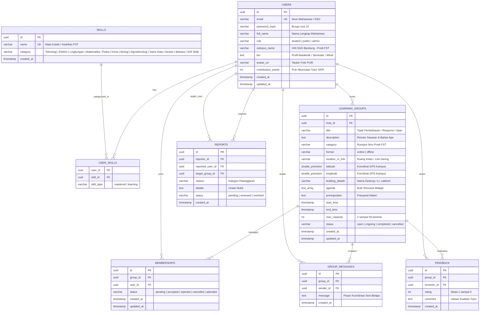

# PRODUCT REQUIREMENTS DOCUMENT (PRD)
## Project: PeerLearn — Platform Kolaborasi Belajar Mahasiswa
### Lingkup Implementasi: Fakultas Sains dan Teknologi (FST), UIN Sunan Gunung Djati Bandung

---

## 1. Dokumen Kontrol & Ringkasan Eksekutif

| Informasi | Keterangan |
| :--- | :--- |
| **Nama Produk** | **PeerLearn (FST UIN SGD Edition)** |
| **Deskripsi** | Platform pembelajaran kolaboratif sebaya (*peer-assisted learning*) nir-biaya (*zero-fee*) yang dirancang khusus untuk memfasilitasi mahasiswa 8 Program Studi di lingkungan Fakultas Sains dan Teknologi, UIN Sunan Gunung Djati Bandung. |
| **Versi Dokumen** | **2.0 (FST UIN SGD Production Specification)** |
| **Dokumen Teknis Terkait** | • [Software Requirements Specification (SRS)](./docs/SRS.md) • [Engineering Guidelines (AGENTS.md)](./AGENTS.md) • [Repository Overview (README.md)](./README.md) |
| **Target Pengguna** | Mahasiswa S1, Asisten Laboratorium, dan Peer Tutor FST UIN SGD Bandung |
| **Arsitektur Teknis** | **Backend:** Golang (Fiber v2, Clean Architecture) **Frontend:** React (Vite SPA), Component-Driven, Tailwind CSS **Basis Data:** PostgreSQL (Neon Tech Serverless, PgBouncer Pooled) **Konektivitas Kampus:** OpenStreetMap & Geolocation GPS Kampus 1 Cipadung & Kampus 2 Soekarno-Hatta |

---

## 2. Latar Belakang & Analisis Kebutuhan FST UIN SGD Bandung

Fakultas Sains dan Teknologi (FST) UIN Sunan Gunung Djati Bandung menaungi 8 program studi sarjana:
1. **S1 Teknik Informatika**
2. **S1 Teknik Elektro**
3. **S1 Teknik Lingkungan**
4. **S1 Matematika**
5. **S1 Fisika**
6. **S1 Kimia**
7. **S1 Biologi**
8. **S1 Agroteknologi**

Berdasarkan studi empiris dinamika perkuliahan di lingkungan FST Kampus 1 Cipadung dan Kampus 2:
1. **Disparitas Pemahaman Awal Mahasiswa:** Pada mata kuliah fundamental sains dan komputasi (Algoritma Pemrograman, Kalkulus, Fisika Dasar, Rangkaian Listrik, Kimia Dasar), mahasiswa baru kerap mengalami kesulitan beradaptasi dengan ritme perkuliahan dan praktikum laboratorium.
2. **Kebutuhan Responsi & Review Praktikum Lab:** Setiap semester, mahasiswa sains dan teknik wajib menempuh praktikum laboratorium (Lab Komputer FST Lt. 3, Lab Terpadu MIPA FST, Lab Lingkungan & Studio Elektro). Mahasiswa sangat membutuhkan forum belajar kelompok untuk persiapan tes awal (*pre-test*), praktikum, dan ujian responsi laboratorium.
3. **Peminatan Riset & Tugas Akhir Interdisipliner:** Banyak proyek akhir atau Program Kreativitas Mahasiswa (PKM) yang membutuhkan kolaborasi lintas program studi (contoh: Internet of Things Agroteknologi + Teknik Elektro, Bioinformatika Biologi + Teknik Informatika), namun belum ada wadah resmi untuk menemukan rekan belajar lintas jurusan.
4. **Ketiadaan Rekam Jejak Terverifikasi untuk SKPI:** Mahasiswa berprestasi yang aktif membimbing rekan seangkatannya atau adik tingkat (*peer tutor*) tidak memiliki bukti rekam jejak formal yang dapat diajukan ke dekanat untuk poin **Surat Keterangan Pendamping Ijazah (SKPI)** pada kategori keaktifan akademik dan kepemimpinan.
5. **Hambatan Finansial Bimbingan Komersial:** Jasa bimbingan belajar komersial di luar kampus berbiaya mahal dan silabusnya sering tidak sesuai dengan kurikulum RPS (Rencana Pembelajaran Semester) dosen FST UIN SGD Bandung.

---

## 3. Visi & Sasaran Produk (Goals & Metrics)

* **Visi:** Mewujudkan budaya gotong royong akademik (*academic peer-learning culture*) yang inklusif, terstruktur, bermartabat, dan berdaya saing tinggi di Fakultas Sains dan Teknologi UIN Sunan Gunung Djati Bandung.
* **Sasaran Utama:**
  1. **Kurikulum Terintegrasi FST:** Menyediakan direktori kurikulum bawaan 81+ mata kuliah riil FST UIN SGD, dilengkapi kemampuan "Pakai Ketik" (*instant custom-add*) bagi mahasiswa yang menempuh mata kuliah pilihan khusus atau topik riset spesifik.
  2. **Koordinasi Pertemuan Kampus Presisi:** Menyediakan preset titik kumpul resmi di lingkungan kampus (Gedung FST Lt. 3 Lab Komputer, Lab Terpadu MIPA, Perpustakaan Utama Cipadung, Gazebo GKB, Kampus 2 Soekarno-Hatta) yang terhubung dengan GPS dan Google Maps.
  3. **Portofolio SKPI Terverifikasi:** Menerbitkan dokumen digital dan cetak resmi "Surat Keterangan Kontribusi Tutor Sebaya" dengan nomor registrasi unik dan akumulasi poin kontribusi untuk lampiran berkas yudisium/SKPI fakultas.
  4. **Komunikasi Real-Time Terkendali:** Menyediakan ruang diskusi privat (*chat polling*) bagi peserta yang telah disetujui host guna koordinasi materi, tugas, dan link pertemuan daring secara aman.

---

## 4. Persona Pengguna di Lingkungan FST

1. **Mahasiswa Pembelajar (*Learner*):**
   * Mahasiswa FST semester 1–6 yang membutuhkan pendampingan materi sulit (misal: Struktur Data, Kalkulus Integral, Mikrobiologi Lingkungan, Rangkaian Logika).
   * Kebutuhan: Menemukan sesi belajar terdekat, melihat kualifikasi tutor, dan mendaftar dengan sekali klik.
2. **Peer Tutor / Asisten Laboratorium (*Host*):**
   * Mahasiswa tingkat atas atau asisten lab yang telah menguasai mata kuliah tertentu dan ingin berbagi ilmu sekaligus mengumpulkan portofolio SKPI.
   * Kebutuhan: Mengatur kuota peserta, memvalidasi peserta yang serius belajar, membagikan agenda belajar, dan mendapatkan penilaian ulasan bintang.
3. **Dosen Pembina & Admin Akademik:**
   * Meninjau iklim belajar komunitas mahasiswa, memoderasi sesi belajar agar terbebas dari kecurangan akademik (misal: jasa joki tugas yang dilarang keras), dan memvalidasi keabsahan poin kontribusi tutor.

---

## 5. Ruang Lingkup Fungsional (Functional Requirements)

### Modul 1: Identitas Akademik & Profil Mahasiswa FST
* **FR-1.1:** Mahasiswa dapat mendaftar menggunakan email kampus (`@uinsgd.ac.id`) atau email pribadi, dengan pencantuman identitas Program Studi resmi di lingkungan FST.
* **FR-1.2:** Autentikasi aman berbasis stateless JWT (*Json Web Token*) dengan rotasi sesi dan verifikasi data pengguna.
* **FR-1.3:** Manajemen Profil Pengguna mencakup nama lengkap, program studi / institusi, biografi akademik, rekam jejak poin kontribusi, serta lencana verifikasi mahasiswa.
* **FR-1.4:** **Kelola Minat & Keahlian Belajar (FST Curriculum Engine):**
  * Katalog 81+ mata kuliah 8 prodi FST UIN SGD Bandung terbagi dalam tab rumpun ilmu.
  * Pencarian teks langsung (*live search*) dengan *instant autocomplete*.
  * Fitur **"Pakai Ketik" Cepat (1-Click Action Bar)**: Mahasiswa dapat mengetikkan topik/mata kuliah baru dan langsung menandainya sebagai *Dikuasai (Siap Bimbing)* atau *Ingin Belajar*.
  * Filter status terpisah: *Semua*, *Dikuasai*, dan *Ingin Belajar*.

### Modul 2: Sesi Belajar Komunitas (*Learning Groups*)
* **FR-2.1:** Host dapat membuka sesi belajar baru dengan memasukkan:
  * Topik / judul kegiatan perkuliahan.
  * Kategori rumpun ilmu (Teknologi, Teknik Elektro, Teknik Lingkungan, Matematika, Fisika, Kimia, Biologi, Agroteknologi, Sains Data, Desain, Bahasa, Soft Skills).
  * Format sesi: **Daring** (link Google Meet/Zoom) atau **Luring** (lokasi fisik kampus).
  * Agenda belajar terstruktur (minimal 1 butir materi bahasan).
  * Prasyarat materi pendukung (*prerequisites*).
  * Tanggal dan jam pelaksanaan (waktu mulai & selesai terverifikasi valid).
  * Kuota maksimal peserta (2 hingga 50 mahasiswa).
* **FR-2.2:** **Integrasi Titik Lokasi Kampus FST UIN SGD Bandung:**
  * Preset titik koordinat GPS 1-klik:
    - *Gedung FST Kampus 1 Cipadung (Lt. 3 Lab Komputer)*: Lat `-6.931754`, Lng `107.717145`.
    - *Perpustakaan Utama Kampus 1 Cipadung*: Lat `-6.932200`, Lng `107.717500`.
    - *Gedung Kuliah Bersama (GKB) Kampus 1*: Lat `-6.931500`, Lng `107.716800`.
    - *Laboratorium Terpadu MIPA FST*: Lat `-6.931850`, Lng `107.717300`.
    - *Kampus 2 UIN SGD (Jl. Soekarno-Hatta)*: Lat `-6.938800`, Lng `107.698000`.
  * Fitur resolver tautan Google Maps (`maps.app.goo.gl` / format koordinat) dengan proteksi SSRF.
  * Tampilan peta interaktif OpenStreetMap pada rincian kegiatan luring.
* **FR-2.3:** Penyelenggara dapat memperbarui status kegiatan (`open` $\to$ `ongoing` $\to$ `completed` / `cancelled`).

### Modul 3: Keanggotaan, Persetujuan & Chat Koordinasi
* **FR-3.1:** Mahasiswa dapat mengajukan permohonan bergabung (*Join Request*) ke sesi belajar yang kuotanya masih terbuka.
* **FR-3.2:** Host dapat meninjau profil pemohon dan melakukan aksi: **Setujui (*Accept*)** atau **Tolak (*Reject*)**.
* **FR-3.3:** **Ruang Diskusi Privat & Sinkronisasi Live (Live Polling):**
  * Anggota yang berstatus `accepted` dan Host mendapatkan akses ke tab Chat Diskusi.
  * Sistem melakukan *silent background polling* otomatis setiap 4 detik untuk memperbarui pesan masuk secara real-time tanpa kedip (*flicker-free*).
* **FR-3.4:** Dasbor "Sesi Saya" memisahkan daftar kegiatan yang sedang diikuti sebagai peserta dan kegiatan yang diselenggarakan sebagai host.

### Modul 4: Umpan Balik, Reputasi & Penerbitan SKPI
* **FR-4.1:** Peserta memberikan rating bintang (1–5) dan ulasan kualitatif kepada tutor setelah sesi berstatus `completed`.
* **FR-4.2:** Sistem menghitung Poin Kontribusi Tutor berdasarkan kelancaran sesi dan ulasan positif peserta.
* **FR-4.3:** **Generator Sertifikat SKPI Digital & Print-Ready:**
  * Surat Keterangan Kontribusi Tutor Sebaya resmi bertanda tangan digital sistem.
  * Mencantumkan Nomor Registrasi Dokumen unik, data diri mahasiswa, program studi, akumulasi poin tutor, serta daftar mata kuliah kurikulum FST yang dibimbing.
  * Dukungan mode cetak printer (*browser print CSS*) dengan standar tata letak dokumen akademik A4.

### Modul 5: Keamanan & Integritas Akademik
* **FR-5.1:** Mahasiswa dapat melaporkan (*report*) sesi belajar atau pengguna yang melanggar kode etik akademik (misal: plagiarisme, joki ujian komersial, perundungan).
* **FR-5.2:** Moderator dapat meninjau laporan dan mengambil tindakan pembekuan akun atau penghapusan sesi.

---

## 6. Kebutuhan Non-Fungsional (Non-Functional Requirements)

1. **Efisiensi Sumber Daya & Kinerja Eksekusi (Golang Fiber v2):**
   * Backend Go berjalan sebagai *native single binary* dengan konsumsi memori *idle* **< 30 MB RAM**.
   * Waktu respon API p95 untuk query katalog dan filter keahlian **< 60 ms**.
2. **Konektivitas Database PostgreSQL (Neon Tech Serverless):**
   * Koneksi *pooled* (PgBouncer) yang kompatibel dengan latensi wilayah Singapura (`aws-ap-southeast-1`).
   * Seluruh query bersifat parameter terikat (*parameterized queries*) guna mencegah serangan SQL Injection.
3. **Kepatuhan Antarmuka & Aksesibilitas (React + Vite):**
   * Tema visual *Clean Light Mode* (#F8FAFC / #FFFFFF) dengan kontras tinggi (WCAG AA).
   * Reflow adaptif sempurna dari ponsel berlayar 360px hingga layar monitor ultrawide 1536px+.
   * Dukungan penuh navigasi keyboard (fokus trap dialog modal, escape close, tab wrap).
4. **Anti-Slop Copywriting:**
   * Seluruh salinan teks antarmuka membumi, akademis, dan relevan dengan realitas perkuliahan mahasiswa FST UIN SGD Bandung (bebas dari jargon AI generik).

---

## 7. Entity-Relationship Diagram (ERD) Spesifikasi FST

---

## 8. Kontrak Endpoint REST API (Go Backend Clean Architecture)

| Method | Endpoint | Akses | Fungsi / Logika Bisnis |
| :--- | :--- | :--- | :--- |
| `POST` | `/api/v1/auth/register` | Publik | Registrasi mahasiswa baru FST |
| `POST` | `/api/v1/auth/login` | Publik | Login & penerbitan token JWT stateless |
| `GET` | `/api/v1/auth/me` | Autentikasi | Pengambilan profil akun aktif |
| `PUT` | `/api/v1/users/profile` | Autentikasi | Pembaruan nama, prodi kampus, dan bio |
| `GET` | `/api/v1/skills` | Publik | Katalog 81+ mata kuliah FST UIN SGD |
| `POST` | `/api/v1/users/skills` | Autentikasi | Sinkronisasi batch keahlian (Kuasai/Belajar) |
| `POST` | `/api/v1/users/skills/custom` | Autentikasi | **Pakai Ketik:** Tambah mata kuliah kustom instan |
| `GET` | `/api/v1/groups` | Publik | Penelusuran sesi belajar (filter prodi, format, pencarian) |
| `POST` | `/api/v1/groups` | Mahasiswa | Pembuatan sesi belajar baru dengan preset kampus FST |
| `GET` | `/api/v1/groups/recommendations` | Mahasiswa | Rekomendasi pintar berdasarkan minat belajar |
| `POST` | `/api/v1/groups/resolve-map` | Mahasiswa | Deteksi otomatis titik koordinat dari link Google Maps |
| `GET` | `/api/v1/groups/:id` | Publik | Rincian lengkap sesi & daftar peserta |
| `PATCH`| `/api/v1/groups/:id/status` | Host | Pembaruan status kegiatan (*ongoing*, *completed*, *cancelled*) |
| `POST` | `/api/v1/groups/:id/join` | Mahasiswa | Pengajuan permohonan bergabung |
| `PATCH`| `/api/v1/memberships/:id/status` | Host | Persetujuan (*accept*) atau penolakan (*reject*) peserta |
| `GET` | `/api/v1/groups/:id/messages` | Anggota | Ambil riwayat chat koordinasi privat |
| `POST` | `/api/v1/groups/:id/messages` | Anggota | Kirim pesan koordinasi baru |
| `GET` | `/api/v1/my-sessions` | Mahasiswa | Ambil seluruh sesi diikuti & dikelola |
| `POST` | `/api/v1/groups/:id/feedback` | Peserta | Kirim rating bintang & ulasan tutor |
| `POST` | `/api/v1/reports` | Mahasiswa | Laporkan pelanggaran kode etik akademik |
| `GET` | `/api/v1/health` | Publik | Pemeriksaan status konektivitas Go & PostgreSQL |

---

## 9. Rencana Verifikasi Kualitas & Standardisasi Rekayasa

Berdasarkan pedoman baku [AGENTS.md](./AGENTS.md):
1. **Pengujian Unit Backend:** Pengujian unit Go (`go test -v ./...`) mencakup otentikasi role, pembuatan sesi belajar, resolusi koordinat peta, dan konsistensi data anggota (100% lulus).
2. **Pengujian Unit Frontend:** Pengujian Vitest React (`npm test`) mencakup 15 berkas uji coba (176 tests) dengan validasi form, penanganan galat jaringan, dan aksesibilitas dialog modal (100% lulus).
3. **Kompilasi Bersih:** `go vet ./...` bersih tanpa peringatan dan `npm run build` sukses dalam hitungan milidetik.
