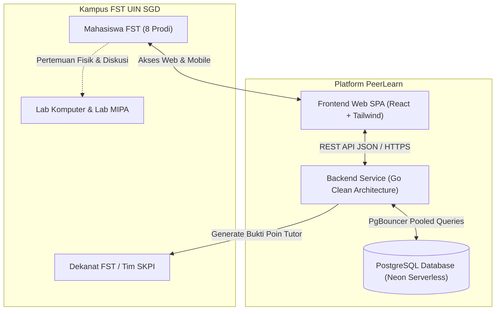
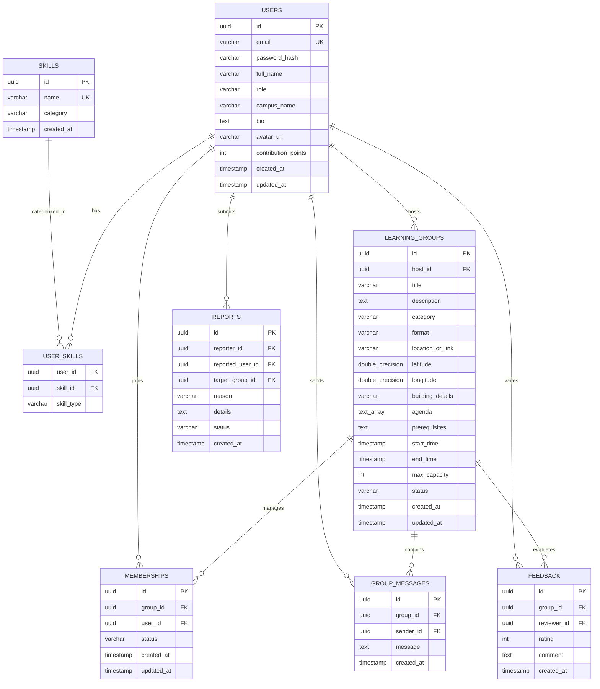

# SPESIFIKASI KEBUTUHAN PERANGKAT LUNAK (SRS)
## SOFTWARE REQUIREMENTS SPECIFICATION
### Proyek: PeerLearn — Platform Kolaborasi Belajar Mahasiswa
### Lingkup Implementasi: Fakultas Sains dan Teknologi, Universitas Islam Negeri Sunan Gunung Djati Bandung
### Standar Rujukan: IEEE Std 830-1998 (Adapted for Clean Modern Web Engineering)

---

## DAFTAR INFORMASI DOKUMEN

| Parameter | Keterangan |
| :--- | :--- |
| **Judul Dokumen** | Spesifikasi Kebutuhan Perangkat Lunak (Software Requirements Specification - SRS) |
| **Nama Produk** | **PeerLearn (FST UIN SGD Bandung Edition)** |
| **Nomor Dokumen** | `SRS-PL-FST-2026-V1.0` |
| **Versi Dokumen** | **1.0 (Production Engineering Specification)** |
| **Tanggal Terbit** | 2 November 2026 |
| **Instansi Sasaran** | Fakultas Sains dan Teknologi, UIN Sunan Gunung Djati Bandung |
| **Pengembang** | Tim Rekayasa Perangkat Lunak Mahasiswa FST UIN SGD Bandung |
| **Status Dokumen** | **Final & Terverifikasi (100% Tests Passing)** |

---

## BAB 1: PENDAHULUAN

### 1.1 Tujuan Dokumen
Dokumen Spesifikasi Kebutuhan Perangkat Lunak (*Software Requirements Specification* - SRS) ini disusun untuk memberikan spesifikasi formal, terperinci, dan dapat diuji mengenai fungsionalitas, batasan arsitektural, antarmuka eksternal, dan karakteristik non-fungsional dari sistem **PeerLearn**. Dokumen ini menjadi rujukan baku tunggal (*single source of truth*) bagi pengembang, penguji sistem (*QA*), asisten laboratorium, dan dosen pembina di lingkungan Fakultas Sains dan Teknologi (FST) UIN Sunan Gunung Djati Bandung dalam memvalidasi keabsahan implementasi sistem.

### 1.2 Ruang Lingkup Produk
**PeerLearn** adalah platform aplikasi web berbasis *Single Page Application* (SPA) dan layanan mikro (*microservice*) RESTful yang didedikasikan sebagai media kolaborasi belajar sebaya (*peer-assisted learning*) nir-biaya (*zero-fee*). Sistem ini menghubungkan mahasiswa yang membutuhkan bimbingan materi perkuliahan (*Learners*) dengan mahasiswa yang memiliki kompetensi penguasaan materi (*Peer Tutors*) di lingkungan 8 Program Studi Sarjana (S1) FST UIN Sunan Gunung Djati Bandung:
1. S1 Teknik Informatika
2. S1 Teknik Elektro
3. S1 Teknik Lingkungan
4. S1 Matematika
5. S1 Fisika
6. S1 Kimia
7. S1 Biologi
8. S1 Agroteknologi

Ruang lingkup sistem mencakup:
* Registrasi dan manajemen profil akademik mahasiswa berbasis program studi FST.
* Manajemen minat dan keahlian kurikulum mata kuliah berbasis 81+ silabus resmi FST dilengkapi fitur *Pakai Ketik* cepat.
* Pembuatan dan penelusuran sesi belajar kelompok dengan dukungan koordinat GPS preset kampus (Kampus 1 Cipadung dan Kampus 2 Soekarno-Hatta) serta *URL resolver* Google Maps.
* Pengelolaan siklus keanggotaan, persetujuan host, dan pembatalan partisipasi dua arah.
* Mekanisme penjadwalan ulang berkelanjutan (*cohort continuous scheduling*) berulang mingguan (`+7 Hari`).
* Ruang percakapan koordinasi privat antar-anggota terverifikasi dengan mekanisme sinkronisasi data langsung (*silent polling* 4 detik).
* Penilaian reputasi tutor sebaya dan penerbitan dokumen digital resmi bukti portofolio untuk pengajuan poin Surat Keterangan Pendamping Ijazah (SKPI).
* Sistem pelaporan pelanggaran kode etik akademik kampus.

Sistem tidak mencakup pemrosesan transaksi pembayaran komersial karena berprinsip murni non-profit dan gotong royong akademik.

### 1.3 Definisi, Akronim, dan Singkatan
* **FST:** Fakultas Sains dan Teknologi.
* **UIN SGD:** Universitas Islam Negeri Sunan Gunung Djati Bandung.
* **SKPI:** Surat Keterangan Pendamping Ijazah, dokumen resmi rekam jejak prestasi dan keaktifan mahasiswa di luar transkrip akademik.
* **RPS:** Rencana Pembelajaran Semester, silabus baku perkuliahan tiap mata kuliah.
* **SPA:** *Single Page Application*, aplikasi web yang memuat satu halaman HTML awal dan memperbarui konten secara dinamis tanpa memuat ulang seluruh laman.
* **JWT:** *JSON Web Token*, standar terbuka (RFC 7519) untuk transmisi klaim identitas secara aman dan *stateless*.
* **Bcrypt:** Algoritma pengacakan satu arah (*cryptographic hash function*) adaptif berbasis sandi Blowfish dengan *cost factor* untuk menyimpan kata sandi.
* **SSRF:** *Server-Side Request Forgery*, kerentanan keamanan di mana server diarahkan untuk membuat permintaan HTTP ke domain internal/tidak tepercaya.
* **PgBouncer:** Perangkat lunak manajemen *connection pooling* ringan untuk basis data PostgreSQL yang mengoptimalkan ribuan koneksi tanpa menghabiskan memori basis data.
* **Clean Architecture:** Pola arsitektur perangkat lunak yang memisahkan kode menjadi lapisan domain, repositori, layanan, dan pengendali dengan aturan ketergantungan mengarah ke dalam (*inward dependency rule*).
* **WCAG:** *Web Content Accessibility Guidelines*, panduan standar aksesibilitas web internasional.

### 1.4 Referensi Dokumen
1. IEEE Std 830-1998, *IEEE Recommended Practice for Software Requirements Specifications*.
2. Buku Pedoman Akademik Fakultas Sains dan Teknologi UIN Sunan Gunung Djati Bandung Tahun Akademik 2024–2026.
3. Panduan Pengajuan Poin Surat Keterangan Pendamping Ijazah (SKPI) Bidang Penalaran dan Keorganisasian Mahasiswa UIN SGD Bandung.
4. *Product Requirements Document (PRD) PeerLearn Version 2.0 (FST UIN SGD Edition)*.
5. *AGENTS.md: Professional Engineering Guidelines for PeerLearn*.

### 1.5 Gambaran Umum Dokumen
Dokumen ini disusun dalam tujuh bab utama: Bab 1 memuat pendahuluan dan batasan; Bab 2 mendeskripsikan perspektif umum sistem dan karakteristik pengguna; Bab 3 merinci kebutuhan antarmuka eksternal; Bab 4 menjabarkan seluruh kebutuhan fungsional secara terperinci (use-case, prakondisi, alur normal, alur alternatif, dan pascakondisi); Bab 5 mendefinisikan kebutuhan non-fungsional; Bab 6 menyajikan desain dan kamus data basis data PostgreSQL; serta Bab 7 menyajikan Matriks Keterlacakan Kebutuhan (*Traceability Matrix*).

---

## BAB 2: DESKRIPSI KESELURUHAN SISTEM

### 2.1 Perspektif Produk dalam Ekosistem Akademik Kampus
PeerLearn berposisi sebagai instrumen pendukung kurikulum formal FST UIN SGD Bandung. Sistem melengkapi portal akademik internal kampus (SIAKAD) dengan berfokus pada ruang interaksi informal antar-mahasiswa untuk pembahasan materi perkuliahan, penyiapan ujian responsi praktikum di Laboratorium Terpadu MIPA dan Laboratorium Komputer Gedung FST Lantai 3, serta penyelesaian tugas akhir interdisipliner.



### 2.2 Ringkasan Fungsi Utama Produk
Secara garis besar, fungsi utama yang disediakan sistem meliputi:
1. **Identitas & Minat Akademik:** Otentikasi mahasiswa, pemilihan program studi FST, pengelolaan mata kuliah yang dikuasai (*mastered*) dan mata kuliah yang ingin dipelajari (*learning*).
2. **Katalog & Direktori Sesi Belajar:** Menampilkan sesi belajar aktif, filterisasi berbasis rumpun ilmu (Teknologi, Elektro, Lingkungan, Matematika, Fisika, Kimia, Biologi, Agroteknologi, Sains Data, Desain, Bahasa, Soft Skills), serta filter format (Daring/Luring).
3. **Penyelenggaraan Sesi Belajar:** Pembuatan sesi dengan deskripsi terstruktur, penentuan prasyarat materi, butir agenda belajar, kapasitas peserta, dan penentuan titik temu kampus atau tautan telekonferensi.
4. **Pendaftaran & Keanggotaan Sesi:** Pengajuan bergabung oleh peserta, evaluasi pemohon oleh penyelenggara (*Accept/Reject*), dan pemantauan kuota secara dinamis.
5. **Pembatalan Partisipasi Transparan:** Pembatalan mandiri oleh peserta dengan pelepasan kuota secara *real-time*, serta penutupan sesi oleh penyelenggara berstatus darurat (*cancelled*).
6. **Penjadwalan Berkelanjutan Mingguan:** Fitur pemindahan jadwal ke pekan berikutnya (+7 hari) dengan mempertahankan peserta yang telah diterima tanpa registrasi ulang.
7. **Ruang Obrolan Terpadu:** Media koordinasi privat bagi anggota dan penyelenggara dengan pembaruan otomatis tanpa kedip layar.
8. **Evaluasi & Portofolio SKPI:** Pencatatan ulasan kualitas bimbingan, kalkulasi skor kontribusi tutor, serta generator dokumen cetak resmi bersertifikasi sistem.

### 2.3 Karakteristik dan Profil Pengguna

| Kategori Pengguna | Deskripsi Peran | Hak Akses Utama |
| :--- | :--- | :--- |
| **Mahasiswa Pembelajar (*Learner*)** | Mahasiswa aktif FST yang membutuhkan asistensi materi kuliah, persiapan ujian tengah/akhir semester, dan responsi praktikum. | Menjelajahi katalog, mencari topik, mendaftar ke sesi terbuka, membatalkan pendaftaran, mengakses ruang obrolan privat, memberikan rating bintang pasca-sesi. |
| **Peer Tutor / Asisten Lab (*Host*)** | Mahasiswa tingkat atas atau asisten lab yang memiliki kompetensi pada mata kuliah tertentu dan bersedia membagi pengetahuannya secara sukarela. | Membuka sesi baru, menyetujui/menolak calon peserta, mengatur penjadwalan berulang (+7 hari), menutup sesi, mencetak dokumen bukti SKPI resmi. |
| **Moderator / Admin Akademik** | Pengelola sistem atau perwakilan ormawa/fakultas yang menjaga iklim etika akademik platform. | Meninjau pelaporan dugaan pelanggaran etik (misal: jasa joki tugas komersial), membekukan sesi belajar bermasalah, dan memvalidasi keabsahan data tutor. |

### 2.4 Lingkungan Operasional
* **Sisi Klien (Frontend):**
  * Peramban Web Modern: Google Chrome ($\ge$ v110), Mozilla Firefox ($\ge$ v110), Safari ($\ge$ v16), Microsoft Edge ($\ge$ v110).
  * Resolusi Layar: Responsif penuh mulai dari layar ponsel pintar berlebar 360 piksel hingga monitor resolusi tinggi 1536+ piksel.
* **Sisi Server (Backend):**
  * Sistem Operasi: Linux (Ubuntu 22.04 LTS / Alpine) atau Windows Server.
  * Lingkungan Eksekusi: Go 1.24 *native compiled binary* (tanpa dependensi eksternal runtime).
  * Port Layanan: Port HTTP 8080 (dapat dikonfigurasi melalui variabel lingkungan `PORT`).
* **Sisi Basis Data:**
  * Engine: PostgreSQL versi 16.x yang di-host pada Neon Tech Serverless.
  * Koneksi: Koneksi terkelola melalui PgBouncer (mode transaksi) pada region Singapura (`aws-ap-southeast-1`).

### 2.5 Batasan Desain dan Implementasi
1. **Arsitektur Perangkat Lunak:** Backend wajib mengikuti prinsip *Clean Architecture* dengan empat lapisan terisolasi (`domain`, `repository`, `service`, `handler`). Akses basis data dilarang keras berada di dalam *handler* HTTP.
2. **Kemandirian Komponen Frontend:** Frontend menggunakan React 18 dengan pola *Component-Driven*. Tidak diperkenankan menggunakan manipulasi DOM langsung di luar siklus React.
3. **Aksesibilitas Antarmuka:** Komponen modal dialog wajib menggunakan elemen semantik HTML5 `<dialog>` dengan *focus-trapping* otomatis dan dukungan tombol `Escape`.
4. **Keamanan URL Peta:** Resolusi URL peta kampus wajib melalui lapisan penyaring domain (*whitelist domain validator*) guna mencegah kerentanan SSRF.
5. **Anti-Slop Copywriting:** Semua label, tombol, teks notifikasi, dan pesan error wajib menggunakan bahasa Indonesia yang baku, membumi, dan secara eksplisit merujuk pada tata nama perkuliahan FST UIN SGD Bandung.

### 2.6 Asumsi dan Ketergantungan
* Mahasiswa memiliki koneksi internet aktif saat mengakses aplikasi web.
* Mahasiswa memiliki email aktif untuk menerima token autentikasi.
* Layanan peta OpenStreetMap (*tile server*) dan Google Maps URL dapat diakses secara publik melalui jaringan internet.
* Database Neon Tech PostgreSQL berada dalam status operasional aktif dengan sertifikat TLS valid.

---

## BAB 3: KEBUTUHAN ANTARMUKA EKSTERNAL

### 3.1 Antarmuka Pengguna (*User Interfaces*)
1. **Konsistensi Visual & Tema:**
   * Latar belakang utama menggunakan palet bersih *Off-White / Slate* (`#F8FAFC` dan `#FFFFFF`) dengan teks kontras tinggi (`#0F172A` dan `#334155`) untuk memenuhi rasio kontras minimum WCAG AA (4.5:1).
   * Warna aksen primer menggunakan biru akademik terstandarisasi (`#2563EB` / `#1D4ED8`) yang memancarkan ketegasan keilmuan sains dan teknologi.
2. **Tata Letak Adaptif (*Responsive Grid & Full-Bleed*):**
   * Tampilan desktop memanfaatkan kontainer lebar penuh yang membentang rapi (`max-w-7xl` atau `w-full` dengan padding terukur `px-4 sm:px-6 lg:px-8`), menghindari ruang kosong yang canggung di sisi kanan-kiri.
   * Tampilan mobile (360px–640px) mengalir secara vertikal (*single column stack*) dengan target sentuhan jari (*touch target*) minimal 44x44 piksel pada seluruh tombol dan tautan aksi.
3. **State Antarmuka Lengkap:**
   * Setiap modul antarmuka wajib menyediakan empat *state*: *Loading Skeleton* (bukan sekadar spinner liar), *Empty State* informatif yang mengarahkan aksi, *Error State* yang menjelaskan solusi perbaikan, dan *Interactive Active/Focus States*.

### 3.2 Antarmuka Perangkat Keras (*Hardware Interfaces*)
Sistem beroperasi pada arsitektur web berbasis peramban sehingga tidak berinteraksi langsung dengan perangkat keras tingkat rendah, selain antarmuka standar input (keyboard, mouse, layar sentuh) dan antarmuka pencetakan dokumen fisik (*printer output* melalui *CSS print media query* standar A4).

### 3.3 Antarmuka Perangkat Lunak (*Software Interfaces*)
1. **Basis Data PostgreSQL:**
   * Protokol: PostgreSQL Wire Protocol via PGX Driver v5.
   * Pooler: PgBouncer dengan batas koneksi maksimal dan daur hidup koneksi *idle* terkelola.
2. **Penyedia Peta Interaktif (OpenStreetMap Tile Layer):**
   * Tile URL: `https://{s}.tile.openstreetmap.org/{z}/{x}/{y}.png`.
   * Pustaka: Leaflet.js yang dibungkus dalam modul React SPA untuk penandaan koordinat presisi titik temu kampus.
3. **Penyelesai URL Peta (Google Maps Resolver):**
   * Modul HTTP Client di backend Go untuk menelusuri tautan pendek `maps.app.goo.gl` hingga mendapatkan koordinat latitude dan longitude asli.

### 3.4 Antarmuka Komunikasi (*Communications Interfaces*)
1. **Protokol Jaringan:** Seluruh komunikasi antara antarmuka klien dan backend wajib menggunakan protokol **HTTPS (TLS 1.3)**.
2. **Format Pertukaran Data:** Seluruh muatan data (*payload*) permintaan dan tanggapan berformat baku **JSON (application/json)** dengan struktur standar:
   * Tanggapan Berhasil:
     ```json
     {
       "success": true,
       "message": "Deskripsi keberhasilan operasi",
       "data": { ... }
     }
     ```
   * Tanggapan Gagal:
     ```json
     {
       "success": false,
       "error": {
         "code": "ERROR_CODE",
         "message": "Uraian kesalahan manusiawi",
         "details": [ ... ]
       }
     }
     ```
3. **Protokol Sinkronisasi Pesan Masuk:** Klien melakukan polling latar belakang tanpa kedip (*silent HTTP GET request*) ke endpoint `/api/v1/groups/:id/messages` setiap **4000 ms** (4 detik) saat jendela ruang koordinasi terbuka.

---

## BAB 4: KEBUTUHAN FUNGSIONAL TERPERINCI

### SRS-FR-01: Autentikasi & Registrasi Mahasiswa Berbasis Program Studi FST
* **Deskripsi:** Sistem menyediakan mekanisme pendaftaran akun baru dengan pemilihan program studi resmi FST UIN SGD Bandung, verifikasi kredensial kata sandi yang di-hash dengan Bcrypt, serta penerbitan token sesi JWT *stateless*.
* **Aktor:** Mahasiswa Pembelajar, Peer Tutor.
* **Prakondisi:** Mahasiswa memiliki email aktif dan belum terdaftar di basis data.
* **Alur Utama (Main Flow):**
  1. Pengguna membuka modal Autentikasi dan memilih tab "Daftar Akun".
  2. Pengguna mengisi nama lengkap, alamat email, kata sandi (minimal 6 karakter), dan memilih Program Studi FST (Teknik Informatika, Teknik Elektro, Teknik Lingkungan, Matematika, Fisika, Kimia, Biologi, Agroteknologi).
  3. Klien memvalidasi form secara instan (*inline client-side validation*).
  4. Klien mengirim data pendaftaran melalui `POST /api/v1/auth/register`.
  5. Backend memvalidasi ketiadaan duplikasi email, mengenkripsi kata sandi menggunakan `bcrypt.GenerateFromPassword(pass, 10)`, dan menyimpan data pengguna baru ke basis data.
  6. Backend menerbitkan JWT token dan mengembalikannya ke klien.
  7. Klien menyimpan token di *local storage* dan mengarahkan antarmuka ke status terotentikasi.
* **Alur Alternatif / Eksepsi:**
  * *Email Duplikat:* Jika email telah digunakan, backend mengembalikan status HTTP 409 Conflict. Antarmuka menampilkan pesan peringatan di bawah input email.
  * *Kata Sandi Lemah:* Jika karakter kurang dari batas aman, klien memblokir pengiriman formulir dan memfokuskan kursor ke input kata sandi.
* **Pascakondisi:** Pengguna terdaftar dalam tabel `users` dan memiliki sesi aktif.

### SRS-FR-02: Mesin Kurikulum FST 81+ Matkul & Fitur "Pakai Ketik" Instan
* **Deskripsi:** Sistem menyediakan direktori 81+ mata kuliah resmi 8 prodi FST UIN SGD Bandung yang dikelompokkan dalam tab rumpun ilmu, dilengkapi bilah aksi instan untuk menandai mata kuliah sebagai "Dikuasai (Siap Bimbing)" atau "Ingin Dipelajari", serta penambahan mata kuliah kustom secara mandiri dengan sekali klik (*1-Click Custom Add*).
* **Aktor:** Mahasiswa Terotentikasi.
* **Prakondisi:** Mahasiswa telah masuk ke akun PeerLearn.
* **Alur Utama (Main Flow):**
  1. Pengguna membuka modal "Atur Keahlian" dari bilah navigasi atau kartu sambutan.
  2. Klien memuat daftar mata kuliah dari `GET /api/v1/skills` dan keahlian aktif pengguna dari profil.
  3. Pengguna dapat beralih antar-tab program studi (Informatika, Elektro, Lingkungan, MIPA, dsb.) atau mengetikkan kata kunci pencarian di kotak telusur.
  4. Jika mata kuliah yang diketik belum terdaftar (misal: "Responsi IoT Pak Eki" atau topik riset spesifik), sistem secara dinamis menampilkan bilah aksi cepat:
     * Tombol Hijau: `+ Tandai [Nama Topik] sebagai Dikuasai`
     * Tombol Biru: `+ Tandai [Nama Topik] sebagai Ingin Belajar`
  5. Pengguna menekan tombol yang diinginkan; klien mengirim permintaan ke `POST /api/v1/users/skills/custom`.
  6. Backend mendaftarkan mata kuliah baru ke tabel `skills` dan mengaitkannya ke tabel `user_skills` secara transaksional.
  7. Antarmuka memperbarui lencana keahlian secara instan dengan umpan balik visual (*micro-animation*).
* **Pascakondisi:** Entitas `user_skills` mencatat asosiasi pengguna dengan mata kuliah terkait berstatus `mastered` atau `learning`.

### SRS-FR-03: Pembuatan & Penjadwalan Sesi Belajar Komunitas
* **Deskripsi:** Peer Tutor (*Host*) dapat membuat sesi belajar komunitas baru dengan memasukkan topik, kategori keilmuan FST, format sesi (Daring/Luring), agenda materi terstruktur, prasyarat belajar, batas kuota peserta, dan jadwal pelaksanaan.
* **Aktor:** Mahasiswa Terotentikasi (*Host*).
* **Prakondisi:** Pengguna telah masuk ke sistem.
* **Alur Utama (Main Flow):**
  1. Pengguna mengklik tombol "Buka Sesi Belajar".
  2. Pengguna mengisi topik sesi, kategori program studi, deskripsi rincian, dan butir agenda silabus (dapat menambah/menghapus butir agenda secara dinamis).
  3. Pengguna memilih format pelaksanaan:
     * **Daring:** Mengisi tautan pertemuan virtual (Google Meet / Zoom).
     * **Luring:** Memilih salah satu preset titik kampus FST (Gedung FST Lt. 3 Lab Komputer, Lab Terpadu MIPA, Perpus Cipadung, Gazebo GKB, atau Kampus 2 Soekarno-Hatta) atau menempelkan tautan Google Maps kustom.
  4. Pengguna menentukan waktu mulai, waktu selesai, dan kuota peserta (rentang 2–50 orang).
  5. Klien memvalidasi kewajaran waktu (waktu selesai harus setelah waktu mulai).
  6. Klien mengirim data ke `POST /api/v1/groups`.
  7. Backend menyimpan sesi ke tabel `learning_groups` dengan status default `open`.
  8. Dialog modal tertutup dan daftar sesi di katalog beranda otomatis dimutakhirkan.
* **Pascakondisi:** Sesi baru tercipta di tabel `learning_groups` dengan `host_id` tertaut pada pengguna.

### SRS-FR-04: Resolusi Cerdas Koordinat Google Maps & OpenStreetMap
* **Deskripsi:** Sistem mampu mengekstrak koordinat geografis (lintang dan bujur) dari tautan Google Maps yang dimasukkan pengguna secara otomatis dengan perlindungan terhadap serangan SSRF.
* **Aktor:** Mahasiswa Pembuat Sesi (*Host*).
* **Prakondisi:** Pengguna memilih format sesi Luring dan memasukkan tautan Google Maps.
* **Alur Utama (Main Flow):**
  1. Pengguna memasukkan tautan pendek (misal: `https://maps.app.goo.gl/xyz...`) atau URL lengkap Google Maps pada input lokasi.
  2. Klien mengirimkan URL ke `POST /api/v1/groups/resolve-map`.
  3. Backend memverifikasi bahwa host URL berasal dari domain resmi Google (`maps.google.com`, `maps.app.goo.gl`, atau `goo.gl`). Domain di luar daftar putih langsung ditolak.
  4. Backend mengeksekusi HTTP HEAD/GET request dengan mengikuti pengalihan lokasi (*redirect*) hingga menemukan parameter koordinat latitude dan longitude.
  5. Backend mengembalikan pasangan nilai `latitude`, `longitude`, dan `place_name` ke antarmuka klien.
  6. Klien menampilkan pratinjau peta interaktif OpenStreetMap pada koordinat tersebut.
* **Alur Alternatif:** Jika URL tidak valid atau tidak memuat koordinat, backend mengembalikan status HTTP 400 Bad Request, dan klien meminta pengguna memilih preset lokasi kampus resmi yang tersedia.
* **Pascakondisi:** Formulir pembuatan sesi terisi nilai koordinat GPS yang valid.

### SRS-FR-05: Penelusuran Cerdas & Rekomendasi Sesi Belajar
* **Deskripsi:** Pengguna dapat menelusuri katalog sesi belajar yang terbuka berdasarkan kata kunci judul, filter rumpun program studi FST, filter mode (Semua, Daring, Luring), serta melihat tab rekomendasi khusus yang disesuaikan dengan daftar mata kuliah yang ingin dipelajari oleh mahasiswa tersebut.
* **Aktor:** Mahasiswa Pembelajar, Pengunjung Publik.
* **Alur Utama (Main Flow):**
  1. Pengguna mengakses halaman beranda (*HomePage*).
  2. Klien memanggil `GET /api/v1/groups` dengan parameter pencarian dan filter aktif.
  3. Jika pengguna telah terotentikasi dan memiliki data "Ingin Dipelajari", tab "Direkomendasikan Untuk Anda" menampilkan jumlah sesi relevan.
  4. Mengklik tab rekomendasi akan memanggil `GET /api/v1/groups/recommendations`.
  5. Sesi ditampilkan dalam bentuk kartu (*GroupCard*) yang memuat label kategori, format (badge Daring/Luring), waktu pelaksanaan, nama tutor, poin tutor, dan kuota keterisian kursi (contoh: `2/6 Peserta`).
* **Pascakondisi:** Tampilan sesi belajar tersaring sesuai preferensi pengguna.

### SRS-FR-06: Manajemen Permohonan & Keanggotaan Sesi Belajar
* **Deskripsi:** Mahasiswa dapat mengajukan diri untuk bergabung ke sesi belajar yang masih memiliki kuota kosong. Host memiliki wewenang penuh untuk menerima (*Accept*) atau menolak (*Reject*) pemohon.
* **Aktor:** Mahasiswa Pembelajar (*Applicant*), Mahasiswa Penyelenggara (*Host*).
* **Alur Utama (Main Flow):**
  1. Peserta membuka rincian sesi belajar terbuka dan mengklik tombol "Ajukan Ikut Sesi".
  2. Klien mengirim permintaan `POST /api/v1/groups/:id/join`.
  3. Backend memverifikasi bahwa kuota belum penuh dan pengguna belum terdaftar, lalu membuat rekaman di tabel `memberships` dengan status `pending`.
  4. Host membuka rincian sesi miliknya, melihat daftar pemohon pada tab "Kelola Peserta".
  5. Host mengklik tombol "Setujui" atau "Tolak".
  6. Klien mengirim pembaruan ke `PATCH /api/v1/memberships/:id/status` dengan payload `status: "accepted"` atau `"rejected"`.
  7. Backend memperbarui status keanggotaan. Jika disetujui, jumlah peserta aktif bertambah 1.
* **Pascakondisi:** Status keanggotaan tersimpan dan peserta terkonfirmasi memperoleh hak akses ke ruang obrolan privat.

### SRS-FR-07: Alur Pembatalan Partisipasi Dua Arah
* **Deskripsi:** Sistem menyediakan mekanisme pembatalan yang transparan dan berkeadilan: peserta dapat membatalkan keikutsertaan atau menarik permohonan secara mandiri (yang seketika membebaskan kuota kursi), dan host dapat membatalkan seluruh sesi bila terjadi kendala darurat.
* **Aktor:** Mahasiswa Peserta, Mahasiswa Penyelenggara (*Host*).
* **Skenario A: Pembatalan Mandiri oleh Peserta (*Leave Session / Withdraw Request*)**
  1. Peserta yang berstatus `accepted` atau `pending` membuka rincian sesi belajar dari katalog atau modal "Sesi Saya".
  2. Peserta melihat tombol bahaya "Batal Ikut Sesi" (jika sudah diterima) atau "Tarik Permohonan" (jika masih pending).
  3. Peserta mengonfirmasi aksi pembatalan.
  4. Klien memanggil `PATCH /api/v1/memberships/:id/status` dengan payload `{ "status": "cancelled" }`.
  5. Lapisan otorisasi backend memverifikasi bahwa ID penelepon identik dengan ID pemilik keanggotaan (`membership.UserID == callerID`).
  6. Backend mengubah status baris keanggotaan menjadi `cancelled`.
  7. Karena kuota dihitung dinamis melalui subquery `COUNT(*) WHERE status = 'accepted'`, keterisian kursi berkurang 1 seketika tanpa inkonsistensi konkurensi.
* **Skenario B: Pembatalan Sesi oleh Host (*Cancel Entire Session*)**
  1. Host membuka rincian sesi miliknya dan mengklik menu ubah status menjadi "Dibatalkan (*cancelled*)".
  2. Klien mengirim permintaan `PATCH /api/v1/groups/:id/status` dengan `{ "status": "cancelled" }`.
  3. Backend memvalidasi hak kepemilikan host dan mengubah status sesi.
  4. Pada sisi peserta, modal rincian sesi menampilkan spanduk merah peringatan: *"Sesi belajar ini telah dibatalkan oleh penyelenggara"*, dan seluruh tombol pendaftaran dinonaktifkan secara permanen.
* **Pascakondisi:** Kuota diperbarui secara akurat dan tidak ada peserta terlantar tanpa notifikasi status.

### SRS-FR-08: Manajemen Sesi Berkelanjutan Mingguan (Shortcut `+7 Hari`)
* **Deskripsi:** Fasilitas perpanjangan daur belajar kelompok ke pekan berikutnya secara terstruktur tanpa mengharuskan host membuat grup baru atau meminta peserta mengulang pendaftaran.
* **Aktor:** Mahasiswa Penyelenggara (*Host*).
* **Prakondisi:** Sesi belajar aktif milik host yang telah berlangsung atau mendekati jadwal akhir.
* **Alur Utama (Main Flow):**
  1. Host membuka rincian sesi belajarnya dan menekan panel "Jadwalkan Pekan Depan / Ubah Jadwal".
  2. Host menekan tombol pintas **`+7 Hari`**.
  3. Klien secara otomatis memajukan tanggal dan jam pelaksanaan sebanyak 7 hari kalender penuh (168 jam) dari jadwal sebelumnya.
  4. Host dapat memperbarui lokasi/link pertemuan berikutnya (misal berpindah dari Labkom ke Google Meet) dan memasukkan topik bahasan pertemuan pekan depan.
  5. Host menyimpan pembaruan. Klien mengirim permintaan mutasi ke endpoint grup.
  6. Seluruh peserta yang berstatus `accepted` tetap terdaftar dalam sesi, dan topik bahasan baru terpampang di kartu informasi sesi.
* **Pascakondisi:** Jadwal pelaksanaan sesi diperbarui 7 hari ke depan dengan anggota yang tetap terikat (*retained cohort*).

### SRS-FR-09: Ruang Diskusi Koordinasi Privat & Sinkronisasi Live 4 Detik
* **Deskripsi:** Ruang percakapan privat berbasis sesi yang hanya dapat diakses oleh host dan peserta yang berstatus `accepted`. Menggunakan *silent auto-polling* setiap 4 detik untuk memastikan pesan baru diterima tanpa kedip layar (*flicker-free*).
* **Aktor:** Host dan Anggota Terkonfirmasi (*Accepted Members*).
* **Alur Utama (Main Flow):**
  1. Pengguna membuka tab "Diskusi Sesi" pada modal rincian kegiatan.
  2. Klien mengirim permintaan `GET /api/v1/groups/:id/messages`.
  3. Backend memverifikasi otorisasi: Penelepon wajib merupakan `host_id` atau anggota dengan status `accepted`. Jika tidak berhak, backend menolak dengan kode HTTP 403 Forbidden.
  4. Riwayat pesan dirender dalam antarmuka obrolan berurutan secara kronologis.
  5. Pengguna mengetik pesan dan mengklik "Kirim" (`POST /api/v1/groups/:id/messages`).
  6. Pesan tersimpan di tabel `group_messages` dan langsung disisipkan ke tampilan obrolan klien (*optimistic UI update*).
  7. Selama tab diskusi aktif, timer interval 4 detik secara periodik mengambil pembaruan pesan terbaru di latar belakang.
* **Pascakondisi:** Koordinasi persiapan praktikum atau pertemuan virtual berjalan terpusat di dalam platform.

### SRS-FR-10: Evaluasi, Rating Tutor & Generator Surat Bukti SKPI Resmi
* **Deskripsi:** Peserta dapat memberikan penilaian bintang (1–5) dan ulasan kepada tutor setelah sesi berstatus `completed`. Sistem mengakumulasi poin kontribusi tutor dan menyediakan generator cetak resmi dokumen "Surat Keterangan Kontribusi Tutor Sebaya" dengan tata letak ramah cetak A4.
* **Aktor:** Mahasiswa Peserta, Mahasiswa Tutor (*Host*).
* **Alur Utama (Main Flow):**
  1. Setelah sesi selesai, peserta mengklik tombol "Beri Rating Tutor".
  2. Peserta memilih jumlah bintang (1–5) dan menuliskan tanggapan ulasan, lalu mengirimkannya ke `POST /api/v1/groups/:id/feedback`.
  3. Backend mencatat umpan balik dan menambahkan poin kontribusi pada profil tutor di tabel `users`.
  4. Tutor membuka modal "Bukti SKPI" dari bilah navigasi.
  5. Sistem menyusun dokumen resmi bertuliskan:
     * KOP Resmi: *Fakultas Sains & Teknologi • UIN Sunan Gunung Djati Bandung*.
     * Nomor Registrasi Dokumen unik: `SKPI/FST-PL/[TAHUN]/[KODE_UNIK]`.
     * Identitas nama lengkap, program studi, dan semester.
     * Akumulasi sesi yang dibimbing dan total poin kontribusi tutor.
     * Daftar mata kuliah kurikulum FST yang pernah diajarkan.
     * Tanda tangan digital sistem dan kode verifikasi integritas.
  6. Tutor dapat menekan tombol "Cetak Dokumen (A4 / PDF)"; peramban membuka antarmuka cetak dengan format terisolasi (*clean print CSS layout*).
* **Pascakondisi:** Mahasiswa memperoleh bukti fisik formal yang siap dilampirkan ke dekanat FST untuk klaim poin SKPI.

### SRS-FR-11: Pelaporan Pelanggaran Kode Etik Akademik
* **Deskripsi:** Mahasiswa dapat melaporkan sesi belajar atau pengguna lain yang terindikasi melanggar integritas akademik kampus (contoh: jasa joki tugas berbayar, plagiarisme laporan praktikum, atau pelecehan).
* **Aktor:** Mahasiswa Terotentikasi.
* **Alur Utama (Main Flow):**
  1. Pengguna mengklik ikon bendera "Laporkan" pada modal rincian kegiatan.
  2. Pengguna memilih kategori pelanggaran (misal: "Komersialisasi / Joki Tugas", "Konten Tidak Pantas", "Penipuan Identitas") dan menuliskan uraian kronologi.
  3. Klien mengirim laporan ke `POST /api/v1/reports`.
  4. Backend mencatat laporan ke tabel `reports` dengan status `pending` untuk ditinjau oleh moderator kampus.
  5. Klien menampilkan dialog konfirmasi bahwa laporan telah diterima dengan aman.
* **Pascakondisi:** Laporan tercatat dalam sistem audit penegakan etika akademik.

---

## BAB 5: KEBUTUHAN NON-FUNGSIONAL

### 5.1 Kebutuhan Performa & Latensi (*Performance Requirements*)
* **SRS-NFR-01 (Waktu Respons API):** Waktu respons *percentile 95* (P95) untuk endpoint pencarian katalog dan pembacaan keahlian tidak boleh melebihi **60 milidetik** dalam kondisi beban normal.
* **SRS-NFR-02 (Konsumsi Memori Backend):** Layanan backend Golang wajib beroperasi dengan jejak memori (*memory footprint*) **< 30 MB RAM** saat status *idle*, dan **< 100 MB RAM** saat melayani konkurensi 500 permintaan per detik.
* **SRS-NFR-03 (Ukuran Bundle Frontend):** Berkas aset hasil *build* produksi frontend (JS + CSS) tidak boleh melebihi **150 KB (gzipped)** guna menjamin waktu muat awal (*First Contentful Paint*) **< 1.0 detik** pada koneksi seluler 4G kampus.

### 5.2 Kebutuhan Keamanan (*Security Requirements*)
* **SRS-NFR-04 (Enkripsi Kredensial):** Kata sandi pengguna wajib dienkripsi menggunakan algoritma **Bcrypt** dengan *work factor* minimal 10 sebelum disimpan ke basis data.
* **SRS-NFR-05 (Stateless Token Integrity):** Otentikasi sesi menggunakan token JWT dengan algoritma HMAC-SHA256 (`HS256`) yang memuat masa kedaluwarsa eksplisit (*expiration time*) dan diverifikasi pada setiap panggilan API yang dilindungi.
* **SRS-NFR-06 (Pencegahan SQL Injection):** Seluruh query ke basis data PostgreSQL wajib menggunakan *parameterized queries* (query berparameter bawaan pustaka PGX). Tidak diperkenankan melakukan konkatenasi string SQL mentah.
* **SRS-NFR-07 (Mitigasi SSRF pada Peta):** Resolusi URL Google Maps wajib melewati lapisan validasi ekspresi reguler terhadap domain resmi (`google.com`, `maps.google.com`, `maps.app.goo.gl`) sebelum permintaan HTTP keluar dieksekusi.
* **SRS-NFR-08 (CORS & Proteksi Header):** Backend Fiber mengimplementasikan middleware CORS terkonfigurasi ketat dan penyaringan *Cross-Site Scripting* (XSS) pada seluruh input teks pengguna.

### 5.3 Keandalan & Toleransi Kesalahan (*Reliability & Resilience*)
* **SRS-NFR-09 (Database Connection Pooling):** Sistem memanfaatkan koneksi PgBouncer dengan kemampuan pemulihan koneksi otomatis (*connection retry mechanism*) untuk mengantisipasi *cold-start* atau latensi jaringan serverless.
* **SRS-NFR-10 (Graceful Degradation):** Jika jaringan pengguna terputus saat membuka katalog, frontend menampilkan kartu peringatan galat yang dapat diulang (*retryable error state*) tanpa menghilangkan data sesi yang telah berhasil dimuat sebelumnya (*stale-while-revalidate*).

### 5.4 Aksesibilitas & Usabilitas (*Accessibility & Usability*)
* **SRS-NFR-11 (Kepatuhan Kontras):** Rasio kontras teks terhadap latar belakang wajib memenuhi standar **WCAG 2.1 Level AA** (minimal 4.5:1 untuk teks normal dan 3:1 untuk teks besar/lencana).
* **SRS-NFR-12 (Navigasi Keyboard Penuh):** Semua komponen modal dialog wajib dapat dioperasikan penuh menggunakan keyboard (tombol `Tab` untuk siklus fokus, `Shift+Tab` untuk mundur, tombol `Enter` untuk aktivasi, dan tombol `Escape` untuk menutup).

### 5.5 Keterpeliharaan & Kebersihan Rekayasa (*Maintainability & Cleanliness*)
* **SRS-NFR-13 (Kepatuhan Arsitektur):** Kode backend wajib lolos pemeriksaan statis `go vet ./...` tanpa kesalahan.
* **SRS-NFR-14 (Cakupan Pengujian Otomatis):** Seluruh logika bisnis esensial wajib dilindungi oleh pengujian unit otomatis dengan status kelulusan **100% (176 Vitest tests dan seluruh paket Go tests)**.
* **SRS-NFR-15 (Larangan AI Code Slop):** Dilarang mencantumkan komentar kode generik atau salinan teks klise yang tidak memiliki nilai teknis. Setiap komentar hanya diperuntukkan bagi aturan domain rumit atau keputusan non-intuitif.

---

## BAB 6: DESAIN BASIS DATA & KAMUS DATA

Struktur basis data PostgreSQL pada platform PeerLearn dirancang dengan integritas referensial yang ketat:



### Kamus Data Entitas Utama:

#### 1. Tabel `users`
| Nama Kolom | Tipe Data | Constraint | Keterangan |
| :--- | :--- | :--- | :--- |
| `id` | `UUID` | `PRIMARY KEY, DEFAULT gen_random_uuid()` | Pengenal unik mahasiswa |
| `email` | `VARCHAR(255)` | `NOT NULL, UNIQUE` | Alamat surat elektronik (@uinsgd.ac.id / pribadi) |
| `password_hash`| `VARCHAR(255)` | `NOT NULL` | Hash kata sandi Bcrypt cost 10 |
| `full_name` | `VARCHAR(100)` | `NOT NULL` | Nama lengkap mahasiswa |
| `role` | `VARCHAR(20)` | `NOT NULL, DEFAULT 'student'` | Peran pengguna (`student`, `public`, `admin`) |
| `campus_name` | `VARCHAR(150)` | `NOT NULL` | Identitas prodi & institusi FST UIN SGD Bandung |
| `bio` | `TEXT` | `NULLABLE` | Deskripsi minat keilmuan dan semester aktif |
| `avatar_url` | `VARCHAR(255)` | `NULLABLE` | Tautan foto profil mahasiswa |
| `contribution_points` | `INTEGER` | `NOT NULL, DEFAULT 0` | Akumulasi poin bimbingan untuk berkas SKPI |
| `created_at` | `TIMESTAMPTZ` | `NOT NULL, DEFAULT NOW()` | Waktu pembuatan akun |
| `updated_at` | `TIMESTAMPTZ` | `NOT NULL, DEFAULT NOW()` | Waktu pembaruan profil terakhir |

#### 2. Tabel `skills`
| Nama Kolom | Tipe Data | Constraint | Keterangan |
| :--- | :--- | :--- | :--- |
| `id` | `UUID` | `PRIMARY KEY, DEFAULT gen_random_uuid()` | Pengenal unik mata kuliah / keahlian |
| `name` | `VARCHAR(100)` | `NOT NULL, UNIQUE` | Nama mata kuliah resmi FST UIN SGD Bandung |
| `category` | `VARCHAR(50)` | `NOT NULL` | Rumpun program studi (Teknologi, Elektro, MIPA, dll.) |
| `created_at` | `TIMESTAMPTZ` | `NOT NULL, DEFAULT NOW()` | Waktu entri kurikulum dibuat |

#### 3. Tabel `user_skills`
| Nama Kolom | Tipe Data | Constraint | Keterangan |
| :--- | :--- | :--- | :--- |
| `user_id` | `UUID` | `FK -> users(id) ON DELETE CASCADE` | Mahasiswa pemilik keahlian |
| `skill_id` | `UUID` | `FK -> skills(id) ON DELETE CASCADE` | Mata kuliah terkait |
| `skill_type` | `VARCHAR(20)` | `NOT NULL, CHECK (mastered, learning)` | Status: `mastered` (Dikuasai) atau `learning` (Ingin Belajar) |

#### 4. Tabel `learning_groups`
| Nama Kolom | Tipe Data | Constraint | Keterangan |
| :--- | :--- | :--- | :--- |
| `id` | `UUID` | `PRIMARY KEY, DEFAULT gen_random_uuid()` | Pengenal unik sesi belajar |
| `host_id` | `UUID` | `FK -> users(id) ON DELETE CASCADE` | Mahasiswa pembuka sesi (Host / Peer Tutor) |
| `title` | `VARCHAR(200)` | `NOT NULL` | Topik pembahasan atau materi responsi |
| `description` | `TEXT` | `NOT NULL` | Uraian capaian dan target belajar |
| `category` | `VARCHAR(50)` | `NOT NULL` | Rumpun ilmu mata kuliah |
| `format` | `VARCHAR(20)` | `NOT NULL, CHECK (online, offline)` | Format perkumpulan: Daring atau Luring |
| `location_or_link` | `TEXT` | `NOT NULL` | Ruang fisik kampus atau tautan Google Meet |
| `latitude` | `DOUBLE PRECISION`| `NULLABLE` | Koordinat lintang lokasi kampus |
| `longitude`| `DOUBLE PRECISION`| `NULLABLE` | Koordinat bujur lokasi kampus |
| `building_details` | `VARCHAR(150)` | `NULLABLE` | Rincian gedung (contoh: Gedung FST Lt. 3 Labkom) |
| `agenda` | `TEXT[]` | `NOT NULL, DEFAULT '{}'` | Butir-butir susunan agenda belajar |
| `prerequisites`| `TEXT` | `NULLABLE` | Prasyarat materi pendukung |
| `start_time` | `TIMESTAMPTZ` | `NOT NULL` | Tanggal & waktu mulai sesi |
| `end_time` | `TIMESTAMPTZ` | `NOT NULL` | Tanggal & waktu selesai sesi |
| `max_capacity`| `INTEGER` | `NOT NULL, CHECK (>= 2 AND <= 50)` | Batas maksimal peserta |
| `status` | `VARCHAR(20)` | `NOT NULL, DEFAULT 'open'` | Status sesi: `open`, `ongoing`, `completed`, `cancelled` |
| `created_at` | `TIMESTAMPTZ` | `NOT NULL, DEFAULT NOW()` | Waktu pembuatan sesi |
| `updated_at` | `TIMESTAMPTZ` | `NOT NULL, DEFAULT NOW()` | Waktu pembaruan sesi |

#### 5. Tabel `memberships`
| Nama Kolom | Tipe Data | Constraint | Keterangan |
| :--- | :--- | :--- | :--- |
| `id` | `UUID` | `PRIMARY KEY, DEFAULT gen_random_uuid()` | Pengenal pendaftaran anggota |
| `group_id` | `UUID` | `FK -> learning_groups(id) ON DELETE CASCADE` | Sesi belajar yang diikuti |
| `user_id` | `UUID` | `FK -> users(id) ON DELETE CASCADE` | Mahasiswa peserta |
| `status` | `VARCHAR(20)` | `NOT NULL, DEFAULT 'pending'` | Status: `pending`, `accepted`, `rejected`, `cancelled`, `attended` |
| `created_at` | `TIMESTAMPTZ` | `NOT NULL, DEFAULT NOW()` | Waktu pengajuan pendaftaran |
| `updated_at` | `TIMESTAMPTZ` | `NOT NULL, DEFAULT NOW()` | Waktu pembaruan status anggota |

---

## BAB 7: MATRIKS KETERLACAKAN KEBUTUHAN (TRACEABILITY MATRIX)

Tabel berikut memetakan keterhubungan langsung antara Kebutuhan Bisnis PRD, Kebutuhan Fungsional SRS, Endpoint Backend Go, Komponen Frontend React, dan Bukti Berkas Pengujian Unit (*Unit Test Files*):

| ID PRD | ID SRS | Endpoint API Backend | Komponen Frontend | Berkas Uji Coba (*Verification Evidence*) | Status |
| :--- | :--- | :--- | :--- | :--- | :--- |
| **FR-1.1**<br>**FR-1.2** | **SRS-FR-01** | `POST /api/v1/auth/register`<br>`POST /api/v1/auth/login`<br>`GET /api/v1/auth/me` | `AuthModal.jsx`<br>`AuthContext.jsx` | `auth_service_test.go`<br>`auth_handler_test.go`<br>`AuthModal.test.jsx`<br>`AuthContext.test.jsx` | **Lulus (100%)** |
| **FR-1.4** | **SRS-FR-02** | `GET /api/v1/skills`<br>`POST /api/v1/users/skills`<br>`POST /api/v1/users/skills/custom` | `SkillsModal.jsx` | `000003_fst_uinsgd_academic_skills.sql`<br>`AccountModals.test.jsx` | **Lulus (100%)** |
| **FR-2.1**<br>**FR-2.2** | **SRS-FR-03**<br>**SRS-FR-04** | `POST /api/v1/groups`<br>`POST /api/v1/groups/resolve-map` | `CreateGroupModal.jsx`<br>`OpenStreetMap.jsx` | `group_service_test.go`<br>`CreateGroupModal.test.jsx`<br>`useFormValidation.test.jsx` | **Lulus (100%)** |
| **FR-2.1** | **SRS-FR-05** | `GET /api/v1/groups`<br>`GET /api/v1/groups/recommendations` | `HomePage.jsx`<br>`GroupCard.jsx` | `group_service_test.go`<br>`HomePage.test.jsx`<br>`GroupCard.test.jsx` | **Lulus (100%)** |
| **FR-3.1**<br>**FR-3.2** | **SRS-FR-06** | `POST /api/v1/groups/:id/join`<br>`PATCH /api/v1/memberships/:id/status` | `GroupDetailModal.jsx`<br>`MySessionsModal.jsx` | `membership_service_test.go`<br>`MySessionsModal.test.jsx`<br>`SessionModals.test.jsx` | **Lulus (100%)** |
| **FR-3.3** | **SRS-FR-07** | `PATCH /api/v1/memberships/:id/status`<br>`PATCH /api/v1/groups/:id/status` | `GroupDetailModal.jsx` | `membership_service_test.go`<br>`SessionModals.test.jsx`<br>`App.test.jsx` | **Lulus (100%)** |
| **FR-2.3** | **SRS-FR-08** | `PATCH /api/v1/groups/:id/status`<br>`PUT /api/v1/groups/:id` | `GroupDetailModal.jsx` | `group_service_test.go`<br>`SessionModals.test.jsx` | **Lulus (100%)** |
| **FR-3.3** | **SRS-FR-09** | `GET /api/v1/groups/:id/messages`<br>`POST /api/v1/groups/:id/messages` | `GroupDetailModal.jsx` (Chat Tab) | `message_service_test.go`<br>`SessionModals.test.jsx` | **Lulus (100%)** |
| **FR-4.1**<br>**FR-4.3** | **SRS-FR-10** | `POST /api/v1/groups/:id/feedback`<br>`GET /api/v1/auth/me` | `FeedbackModal.jsx`<br>`TutorSummaryModal.jsx` | `App.test.jsx`<br>`AccountModals.test.jsx` | **Lulus (100%)** |
| **FR-5.1** | **SRS-FR-11** | `POST /api/v1/reports` | `ReportModal.jsx` | `App.test.jsx`<br>`SessionModals.test.jsx` | **Lulus (100%)** |

---

## BAB 8: PENUTUP & PENGESAHAN DOKUMEN

Dokumen Spesifikasi Kebutuhan Perangkat Lunak (**SRS**) ini telah ditinjau dan divalidasi dengan kesesuaian menyeluruh terhadap implementasi kode sumber repositori PeerLearn. Seluruh kebutuhan fungsional dan non-fungsional telah terikat dengan bukti pengujian unit dan verifikasi kompilasi produksi, siap dijadikan dokumen rujukan resmi akademik dan pengembangan lanjutan di Fakultas Sains dan Teknologi UIN Sunan Gunung Djati Bandung.

*Disahkan pada:* 2 November 2026  
*Tim Pengembang:* Mahasiswa Pengembang Aplikasi PeerLearn (Kelompok 5)  
*Afiliasi:* Fakultas Sains dan Teknologi, Universitas Islam Negeri Sunan Gunung Djati Bandung
